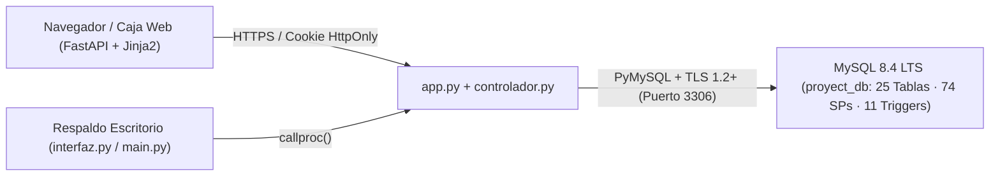

# Sistema POS/ERP — Heladería Polo Norte (`proyect_db`)

**Universidad Nacional de Trujillo** — Facultad de Ciencias Físicas y Matemáticas — Escuela Profesional de Ingeniería Informática  
**Experiencia Curricular:** Base de Datos II (Unidad 3)  
**Motor de Base de Datos:** MySQL Server (`proyect_db`, compatible con MySQL 8.4 LTS / Azure Database for MySQL)  
**Aplicación:** Web **FastAPI + Jinja2** *(con respaldo local de escritorio `tkinter`/`ttk`)*

---

## Arquitectura Centrada en MySQL

Toda la lógica de negocio, cifrado `SHA-256`, cálculo de carrito y vuelto, blindaje de precios oficiales, correlativos atómicos con `FOR UPDATE`, arqueos por sede, analítica ejecutiva y trazabilidad automática reside en **MySQL (`proyect_db`)**:

- **25 Tablas Base** (`0` tablas extra fuera del diagrama relacional + `credenciales_hash` y `bitacora_auditoria`).
- **1 Vista (`VIEW`):** `vw_credenciales_roles` (`SQL SECURITY INVOKER`, colación `utf8mb4_general_ci`).
- **74 Stored Procedures (`sp_*`):** 100% de las consultas, transacciones ACID y analítica.
- **11 Triggers:** Auditoría automática de catálogo, insumos, ventas, toppings, compras y personal.
- **Capa Python ([controlador.py](controlador.py) + [app.py](app.py)):** Cero consultas SQL embebidas y cero cálculos de negocio; invoca exclusivamente `cursor.callproc("sp_*", args)`.



---

## Modelo de Seguridad y Acceso

| Tipo de Acceso | Cuenta | Rol | Alcance | Seguridad |
| :--- | :--- | :--- | :--- | :--- |
| **Gestión Interna** | `admin` | Gerencia General | Todas las sedes (Panel, POS, Arqueo, Catálogo, Almacén, Clientes, Personal, Historial) | `SHA-256` (bloqueo al 3er intento) |
| **Gestión Interna** | `rrhh_etel` | Recursos Humanos | Nómina, sedes y productividad | `SHA-256` (bloqueo al 3er intento) |
| **Gestión Interna** | `log_joel` | Logística y Almacén | Catálogo, toppings, recetas, insumos, almacenes, proveedores y compras | `SHA-256` (bloqueo al 3er intento) |
| **Caja Diaria** | `caja_quintanas` | Caja — Sede Quintanas | POS, arqueo, tickets y clientes (aislamiento Sede 1, serie `B001`/`F001`) | Ingreso directo 1 clic |
| **Caja Diaria** | `caja_upao` | Caja — Sede UPAO | POS, arqueo, tickets y clientes (aislamiento Sede 2, serie `B002`/`F002`) | Ingreso directo 1 clic |
| **Caja Diaria** | `caja_mall` | Caja — Sede Mall Plaza | POS, arqueo, tickets y clientes (aislamiento Sede 3, serie `B003`/`F003`) | Ingreso directo 1 clic |

*(Credenciales iniciales de laboratorio definidas en `archivos_bd/seguridad_roles_hash.sql`: `admin` / `admin123`, `rrhh_etel` / `rrhh123`, `log_joel` / `log123`.)*

---

## Ejecución Local

1. **Importar la base de datos reproducible en MySQL:**
   ```bash
   mysql --default-character-set=utf8mb4 -u root -p -e "CREATE DATABASE IF NOT EXISTS proyect_db CHARACTER SET utf8mb4 COLLATE utf8mb4_general_ci;"
   mysql --default-character-set=utf8mb4 -u root -p proyect_db < archivos_bd/proyect_db_cloud_84.sql
   ```
2. **Instalar dependencias y configurar entorno:**
   ```bash
   pip install -r requirements.txt
   cp .env.example .env
   ```
   Completa tus credenciales locales en `.env` (`DB_HOST`, `DB_PORT`, `DB_USER`, `DB_PASSWORD`, `DB_NAME=proyect_db`).
3. **Iniciar la aplicación web (o el respaldo de escritorio):**
   ```bash
   uvicorn app:app --host 127.0.0.1 --port 8000
   ```
   *(Respaldo Tkinter: `python main.py`)*

---

## Despliegue en la Nube (Azure MySQL 8.4 LTS + Render Free)

- **Base de Datos:** Azure Database for MySQL Flexible Server (`8.4 LTS`) con `require_secure_transport=ON`, `time_zone=-05:00` y `log_bin_trust_function_creators=ON`, restaurado desde [archivos_bd/proyect_db_cloud_84.sql](archivos_bd/proyect_db_cloud_84.sql).
- **Web App:** Definida de forma declarativa en [render.yaml](render.yaml) (`APP_ENV=production`, `DB_SSL=1`, `SESSION_SECRET` generado automáticamente en Render y validación `Origin`/`Referer` anti-CSRF).
